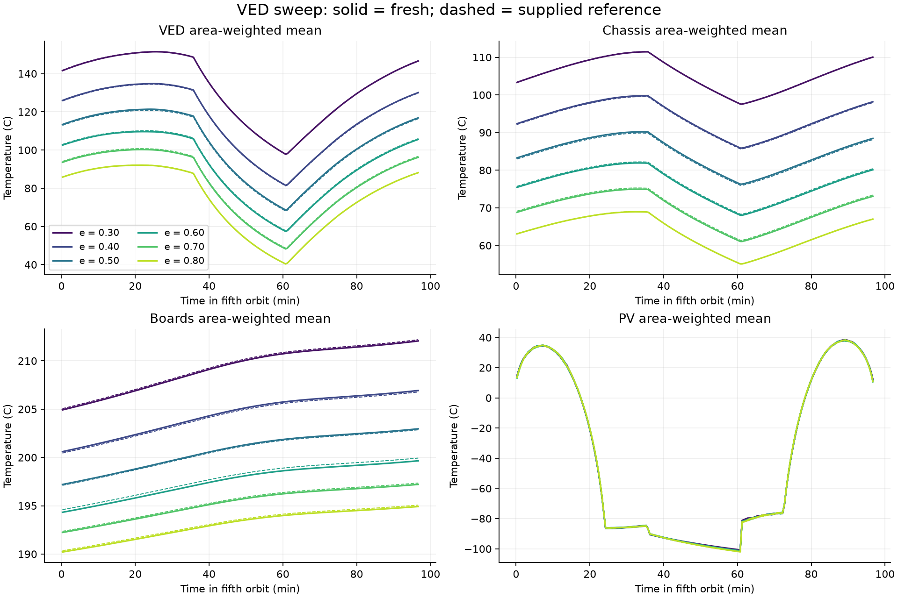

# VED sweep: fresh-run comparison

All six cases were independently recalculated from Recreated_VED_Sweep.dwg. Every completed run contains 705 unique saved nodes, 968 times and a final time of 29006.18 s. Temperatures are finite and initial values match 293 K spacecraft / 3 K space. Original files are preserved.

## How close are the results?

Largest absolute fresh-minus-reference difference over the full saved history (K):

| Case | VED mean | Chassis mean | Boards mean | PV mean | Any node |
|---|---:|---:|---:|---:|---:|
| VED_e030 | 0.232 | 0.102 | 0.137 | 1.128 | 4.327 |
| VED_e040 | 0.444 | 0.262 | 0.154 | 0.820 | 4.050 |
| VED_e050 | 0.650 | 0.363 | 0.099 | 1.046 | 4.985 |
| VED_e060 | 0.520 | 0.303 | 0.282 | 0.725 | 4.007 |
| VED_e070 | 0.611 | 0.342 | 0.145 | 1.055 | 4.960 |
| VED_e080 | 0.156 | 0.075 | 0.146 | 0.955 | 4.570 |

These are numerical reproduction differences, not a pass/fail verdict. No engineering acceptance tolerance was supplied. See comparison.csv for RMSE, signed bias and worst times; node_comparison.json gives every node.

Solid curves are fresh; dashed curves are supplied references. [Full startup](ved_figures/startup.png) and [difference curves](ved_figures/differences.png) show the entire history.

## Fifth-orbit VED behavior

| Emissivity | Fresh min (C) | Fresh max (C) | Fresh time mean (C) | Largest orbit 4-to-5 drift (K) |
|---|---:|---:|---:|---:|
| 0.30 | 97.78 | 151.46 | 132.30 | 8.60 |
| 0.40 | 81.52 | 134.80 | 115.90 | 7.07 |
| 0.50 | 68.60 | 121.36 | 102.76 | 5.98 |
| 0.60 | 57.40 | 109.63 | 91.40 | 5.15 |
| 0.70 | 48.23 | 100.24 | 82.09 | 4.51 |
| 0.80 | 40.37 | 92.07 | 74.07 | 4.00 |

The fifth-orbit boundaries are interpolated at 4P and 5P, P=5801.23510345288 s. Time means use trapezoidal integration. Extrema are saved-sample/interpolated extrema; faster peaks may be missed. These runs are startup transients, not demonstrated periodic equilibrium.

## Why the curves are not identical

RadCAD radiation was recalculated, not copied from the reference. Its Monte Carlo radiation coefficients differ. The normalized thermal-deck body from MAIN node definitions onward matches the recovered original in all six cases (thermal_deck_audit.json); the output-saving wrapper differs. This supports radiation sampling as a likely contributor, but is not a quantified uncertainty bound or a full convergence study. The logs report 5000 rays per node and 48 nodes (6%) with a weighted-error diagnostic above 25; this is a radiation sampling diagnostic, not a temperature-error percentage. Inspect the retained radiation logs and increase ray counts in a separate convergence study before accepting differences for design decisions.

## What this does and does not establish

The reference uses area-weighted component means, reproduced here using component_node_weights.json. Those weights reproduce the supplied component CSVs from supplied node CSVs within 6e-13 K. Chassis includes VED. The app's default All nodes mean instead counts every unique saved node equally, including SPACE.1; it should not be compared directly with these curves.

The design binder describes different COMSOL component studies as well as appendix inputs. Its 1000 km/6600 s switched-emissivity VED case and point-temperature plot are not this 600 km fixed-emissivity full-model sweep. No claim of cross-solver agreement with COMSOL is made. PV properties, inferred assignments, omitted volumetric battery heating and drift remain model limitations. See the run guide for the exact settings and binder page references.

## Reproduce and extend

Read [the simple run guide](VED_QUICKSTART.md). The bundle contains model databases, reference CSVs/graphs, fresh histories, comparison tables, solver evidence and the scripts. The first case ran through the workbench runner; the remaining five used freshly generated OpenTD decks and concurrent SINDA executions. Both routes used the stored case physics with customization off and no symbol overrides. Completion was checked from solver messages plus saved data, not process return code alone.

[Reflectivity research](REFLECTIVITY.md): reflection is already included by RadCAD, and the fresh reflected-absorbed-power reports contain nonzero values. The next extension is a targeted optical-property sweep and reflected-power reporting. Predicting the coating properties themselves would need measured data or a separate thin-film optical model.

The complete dataset and model dependencies are delivered separately in `VED-study-bundle.zip`; raw CAD and node histories are not tracked in Git.
